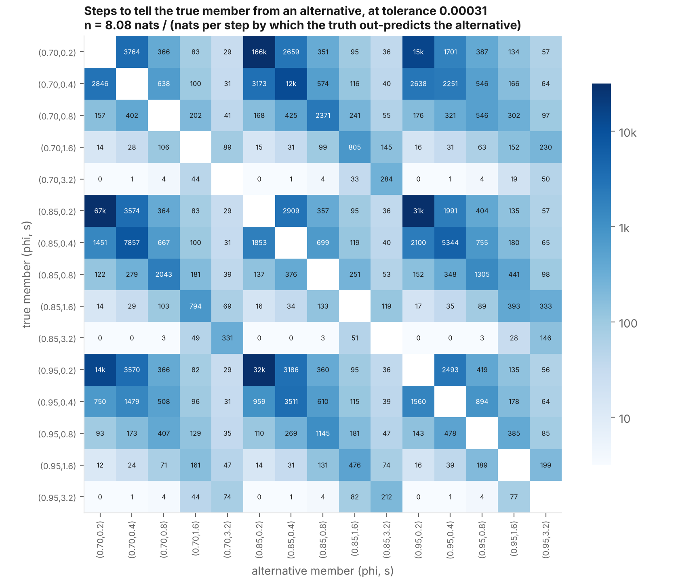
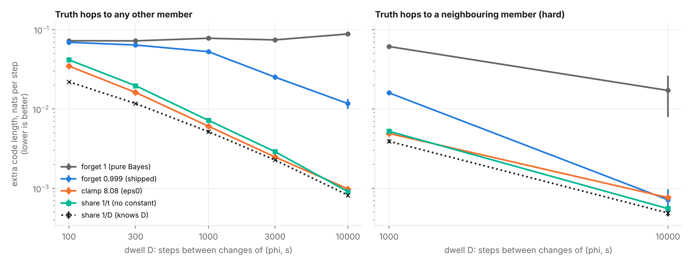
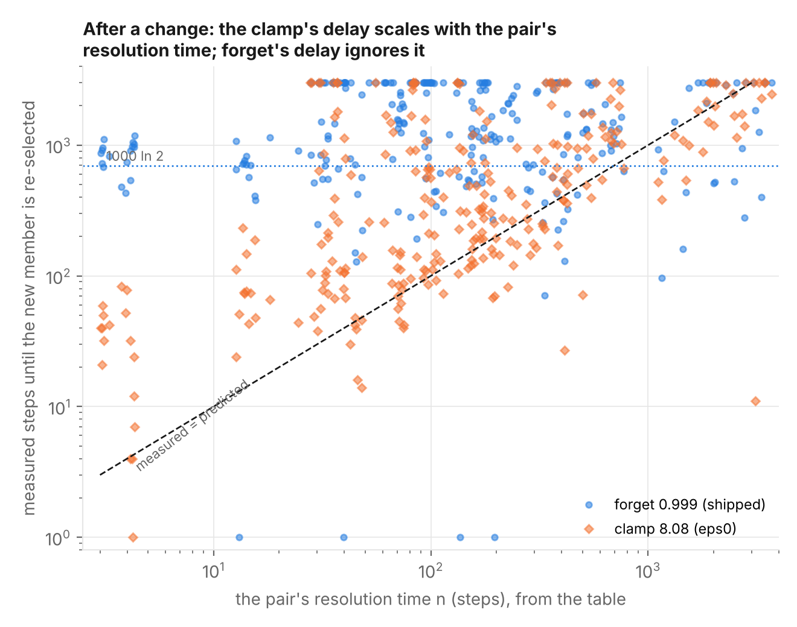

# 0001 — the per-pair resolution time, and what replaces `forget` on a scalar rig

> **AI-generated, not peer-reviewed.** Code
> [`0001_pairwise_resolution.py`](0001_pairwise_resolution.py), output
> [`0001_output.txt`](0001_output.txt), predictions written first in
> [`0001_predictions.md`](0001_predictions.md). One scalar rig; the shipped filter is not
> touched.

> **⚖️ ATTRIBUTION —** _A floor on model weights (equivalently a cap on log-odds) and a
> share rate decaying as `1/t` are standard tools for tracking a changing best model._
> Prior art: fixed share, Herbster & Warmuth 1998; decreasing share / switch distribution,
> van Erven, Grünwald & de Rooij 2007, Koolen & de Rooij; weight lower-bounding in
> multiple-model filters (Bar-Shalom); forgetting as approximate model switching, Raftery,
> Kárný & Ettler 2010. Cited from memory, not re-read. What is measured here is the
> shipped `(phi, s)` box's resolution-time table and the race against `forget`.
> Status: RECOMBINATION + measured results.

## The question

`forget` gives the bank one memory length, `1/(1 − forget)` steps, for every pair of
`(phi, s)` members. The proposal: evidence between two members should be forgotten on the
time it takes to tell *those two* apart. Does that work, and does it remove the constant?

## The rig

`e_t = exp(lam_t/2)·z_t`, `lam` a stationary AR(1) log-variance with memory `phi` and
spread `s`, about a known common log-level. The 15 members of the shipped box
(`_PHIS × _SS`) each run an exact-to-quadrature grid filter (65 nodes; a 129-node check
moves the divergences by 4e-6). A member's predictive likelihood does not depend on how the
weights are combined, so every weight rule is replayed on the same likelihoods. Score: code
length, as extra nats per step against the member that is currently true.

## A. The table: there is no single resolution time

`KL_ij` is the nats per step by which the truth `i` out-predicts the alternative `j`; the
resolution time at tolerance `eps` is `n_ij = ln(1/eps)/KL_ij`. At the repository's one
tolerance `eps0 = 3.1e-4` (8.08 nats):

- `n_ij` spans **under 1 step to 166,000 steps** (median 116). 13% of ordered pairs resolve
  in under 10 steps; 3% need more than 10,000.
- **`s` is cheap, `phi` is expensive**, as the ridge findings say. Neighbours in `s`:
  44–3,800 steps. Neighbours in `phi`: 150–166,000 steps.
- **The small-`s` corner is the hard one.** At `s = 0.2`, telling `phi = 0.70` from `0.85`
  takes 67k–166k steps. Those members are, for any practical record, one member.
- 85% of ordered pairs resolve within 1000 steps. The 1000-step memory of `forget = 0.999`
  is not singled out by the table; it sits where `s`-neighbours at the low rungs begin to
  resolve (1,500–3,800) and far above what most pairs need. The shift adaptive-grid
  finding 16 tuned on (`s` 0.25 → 0.70) corresponds to 140–480 steps here.

So a single memory is wrong for most pairs in one direction or the other. That is the case
for a per-pair rule.

## B. The race

Extra code length, nats per step × 1000 (± is the SE over 8 records; static is over the
15 members). "any" = the truth hops to a random other member every `D` steps; "nbr" = to a
grid neighbour.

| rule | static | any 100 | any 300 | any 1000 | any 3000 | any 10000 | nbr 1000 | nbr 10000 |
|---|---|---|---|---|---|---|---|---|
| `forget = 1` (pure Bayes) | 0.01 | 72.5 | 72.3 | 77.9 | 74.3 | 88.3 | 61.3 | 17.1 |
| `forget = 0.9999` | 0.01 | 71.6 | 72.1 | 75.3 | 66.2 | 60.5 | 51.0 | 5.4 |
| **`forget = 0.999` (shipped)** | 0.11 | 69.3 | 64.0 | 52.8 | 25.2 | 11.7 | 16.0 | 0.72 |
| `forget = 0.99` | 2.45 | 46.3 | 25.0 | 10.8 | 5.0 | 3.4 | 4.2 | 2.08 |
| clamp 2.0 nats | 37.6 | 39.2 | 38.2 | 40.7 | 40.4 | 41.3 | 34.7 | 25.1 |
| clamp 4.5 nats | 9.2 | 23.9 | 14.6 | 11.2 | 10.1 | 9.9 | 10.0 | 6.4 |
| **clamp 8.08 nats (`eps0`)** | 0.35 | 34.7 | 16.2 | 6.1 | 2.5 | 0.98 | 4.9 | 0.76 |
| clamp 12 nats | 0.02 | 46.9 | 23.5 | 8.9 | 3.4 | 1.02 | 6.8 | 0.79 |
| ceiling (per-pair cap, no constant) | 49.9 | 54.3 | 53.6 | 56.7 | 55.2 | 55.2 | 48.6 | 32.7 |
| literal per-pair forgetting | 1495 | 836 | 927 | 985 | 1133 | 1326 | 814 | 449 |
| **share `1/t` (no constant)** | 0.10 | 41.7 | 19.7 | 7.2 | 2.9 | 0.91 | 5.2 | 0.55 |
| share `1/D` (told the true dwell) | – | 22.0 | 11.7 | 5.2 | 2.3 | 0.82 | 3.9 | 0.49 |

Rules, exactly:

- **clamp `c`**: accumulate as pure Bayes, then `logw <- max(logw, max(logw) − c)`. No
  member is ever more than `c` nats behind the leader.
- **share `1/t`**: accumulate as pure Bayes, then `w <- (1 − a_t)·w + a_t/M` with
  `a_t = 1/(t+1)`, `t` the number of steps so far. The floor decays as one over the run
  length. Nothing is chosen.

## What the predictions got right and wrong

| | prediction | verdict |
|---|---|---|
| P1 | `forget` imposes one re-selection time on every pair, `≈ 0.69·T` | **half right.** Its delay is uncorrelated with the pair's resolution time (r = +0.05), as predicted. But the value is 420 / 1240 / 3000+ steps at the 10 / 50 / 90th percentile, not 693: it depends on the *asymmetry* `KL_ij/KL_ji`, which is large in this bank |
| P2 | per-pair forgetting collapses to a log-odds cap, whose delay is the pair's own `n_ji` | **supported, loosely.** The clamp's delay tracks `n_ji` (r = +0.59) but runs a median 2× slower with a 0.85-decade spread; heavy-tailed evidence arrives in bursts |
| P3 | the literal per-pair rule behaves like the clamp | **FALSE.** It is the worst rule by two orders of magnitude. Pairs with different memories give log-odds that do not add up around a triangle, and pairs that resolve in under one step keep no memory at all and inject raw noise. Tested in one realisation (member score = mean of its pairwise log-odds) |
| P4 | clamp costs ≈ `c` per change and ≤ 0.0043/step static | **supported.** 6.1 nats per change at `D = 1000`, 9.8 at `D = 10000`; static 0.00035 |
| P5 | closing the loop with the resolvability ceiling gives constant-free caps of 5–12 nats | **FALSE.** Caps come out 1.2–14.7 nats, and the low ones (pairs separated by more than a nat per step) make the bank flip on single draws. As bad as clamp 2.0 |
| P6 | share `1/t` sits within a few nats per change of the clamp | **supported.** Within 20% of clamp-`eps0` at every dwell ≥ 300, better on static and on slow neighbour hops, and within 10–90% of the rule that is told the true dwell |

## Reading

1. **The per-pair behaviour is right; per-pair parameters are not needed and do harm.**
   A pair-blind cap on how far any member may fall behind makes each pair's memory equal to
   its own resolution time automatically, because that is how long it takes to climb back
   from the cap. Supplying the table explicitly (literal per-pair forgetting, the ceiling
   caps) lost badly both ways it was tried.

2. **Against the shipped `forget = 0.999` on this rig**: the clamp at `eps0` is 9–12× better
   when the truth hops between arbitrary members at dwells of 1000–10000, 3× better on
   neighbour hops at 1000, equal on neighbour hops at 10000, and 3× worse on a static truth
   (0.00035 against 0.00011 nats/step — both negligible beside the 0.001–0.05 at stake when
   anything changes). Share `1/t` matches `forget = 0.999` on static and matches or beats
   it everywhere else.

3. **The clamp still has a constant; share `1/t` does not.** The clamp's tolerance matters
   below about 8 nats (clamp 4.5 is 2–10× worse than clamp 8 on slow dwells and static) and
   barely above it (8 against 12: within 40%). `eps0` is a defensible value but is a
   tolerance traded two ways, not a budget in the audit's sense. Share `1/t` has nothing to
   set, and since its rate is `1/(elapsed steps)`, a change of sampling rate rescales it
   consistently.

> **Correction after review.** Share `1/t` is not admissible. Its rate depends on the index
> of the observation, i.e. on where the record began, which breaks the time-homogeneity the
> class rests on. Reading 3's "consistent under a change of sampling rate" is true but beside
> the point: it is scale-free and origin-dependent, where the requirement is origin-free.
> The clamp is origin-free *and* timescale-free; its constant is a dimensionless level. The
> numbers below stand as measurements only.

4. **The cost of share `1/t` is logarithmic stickiness.** After a run of `t` steps a change
   costs about `ln(M·t)` nats to notice, against pure Bayes's cost that grows linearly in
   `t`. At `t = 10^6` that is 16.5 nats, twice the clamp's 8.

## Limits

- One rig: scalar, pure regime, known level, truths exactly on the bank's grid, abrupt hops
  rather than slow drift. The shipped filter's level walk, split ladder and fault channel
  are absent.
- Code length of the bank's mixture is the score. adaptive-grid finding 16 measured that
  the *state estimate* is nearly indifferent to `forget`, because the level walk tracks
  regardless. A large code-length gain here may be a small RMSE gain there.
- The resolvability ceiling as a constant-free principle (P5) failed in the form tried. The
  idea that the class may not move faster than it can be resolved is not refuted; the
  specific fixed point is.
