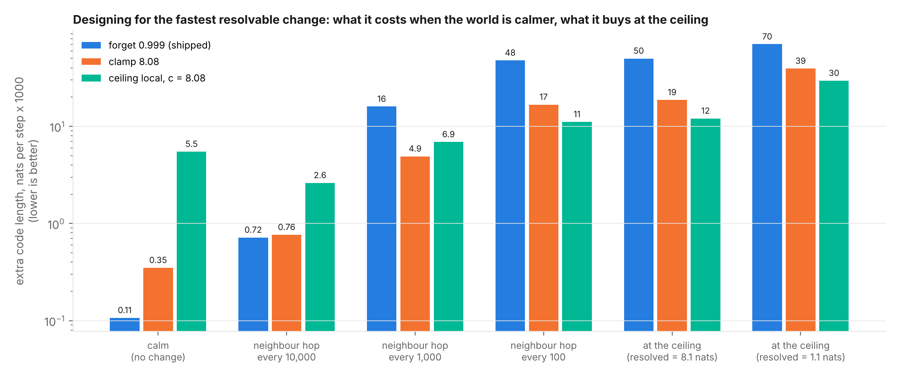

# 0002 — the resolvability ceiling as the model

> **AI-generated, not peer-reviewed.** Code
> [`0002_the_ceiling_world.py`](0002_the_ceiling_world.py), output
> [`0002_output.txt`](0002_output.txt), predictions written first in
> [`0002_predictions.md`](0002_predictions.md). Same scalar rig as `0001`
> ([`rig.py`](rig.py)); the shipped filter is not touched.

> **⚖️ ATTRIBUTION —** _A bank filtered under a Markov chain over its members is the
> interacting-multiple-model / hidden-Markov construction._ Prior art: Blom & Bar-Shalom
> 1988; Rabiner 1989. What is specific here is the choice of rates — one over each pair's
> resolution time — and its measured cost. Status: RECOMBINATION + measured results.

## The principle

`(phi, s)` change as fast as they can and still be resolved. Made exact: the truth is a
time-homogeneous chain over the bank's members with rate `h_ij = KL_ij / c` from `i` to
`j`, i.e. one over the pair's resolution time, where `c` is the evidence that counts as
resolved. The weight rule is the exact Bayes filter for that chain: Bayes update, then
`w <- w @ P`. It has no timescale of its own and no origin.

Two readings of which moves exist (**local**: grid neighbours only; **full**: any pair) and
two of `c` (1.125 nats, the repository's spacing criterion of 1.5 blur widths; 8.08 nats,
`ln(1/eps0)`).

## Result

Extra code length, nats per step × 1000, against the currently-true member.

| rule | calm | any 100 | any 1000 | any 10000 | nbr 100 | nbr 1000 | nbr 10000 | ceiling world, c=8.08 | ceiling world, c=1.125 |
|---|---|---|---|---|---|---|---|---|---|
| `forget = 0.999` (shipped) | 0.11 | 69.3 | 52.8 | 11.7 | 47.8 | 16.0 | 0.72 | 50.0 | 70.1 |
| clamp 8.08 | 0.35 | 34.7 | 6.1 | 0.98 | 16.7 | 4.9 | 0.76 | 18.7 | 39.4 |
| **ceiling local, c = 8.08** | 5.5 | 26.6 | 9.1 | 6.0 | 11.1 | 6.9 | 2.6 | **12.1** | 29.5 |
| ceiling local, c = 1.125 | 12.6 | 24.7 | 14.8 | 13.4 | 14.7 | 13.2 | 6.7 | 15.1 | **25.7** |
| ceiling full, c = 8.08 | 64.3 | 64.7 | 67.7 | 67.0 | 60.6 | 58.8 | 65.2 | 65.7 | 64.9 |
| ceiling full, c = 1.125 | 65.1 | 65.5 | 68.7 | 67.8 | 61.4 | 59.6 | 65.5 | 66.5 | 65.5 |

"Ceiling world" is a truth drawn from the local chain itself (mean dwell 96 steps at
`c = 8.08`, 14 steps at `c = 1.125`); the matching local rule is exactly Bayes-optimal
there (bold).

## Predictions against the run

| | prediction | verdict |
|---|---|---|
| Q1 | full is poor everywhere | **confirmed** — 59–69 in every column. A wide-`s` member is told from a narrow one in about a step, so the principle places no limit on that move; every row hits the 1/2 cap. Predicted magnitude (>100) was too high |
| Q2 | local pays about its own hop rate when calm | **confirmed in form** — static regret is 0.47–1.00 × the member's total neighbour rate (median 0.57) across all 15 members. 5.5 at `c = 8.08` as predicted; 12.6 at `c = 1.125`, lower than the 30–80 predicted |
| Q3 | local wins at the ceiling by 1.5–3× over the clamp | **confirmed** — 12.1 against 18.7 (1.55×) and against 50.0 for `forget` (4.1×) |
| Q4 | local loses on arbitrary hops, ties the clamp on neighbour hops at 1000 | **partly** — it loses at dwell ≥ 1000 on both hop types (6.9 against 4.9; 9.1 against 6.1) and *wins* at dwell 100 on both (11.1 against 16.7; 26.6 against 34.7) |
| — | mind-change test: local within 2× of the clamp when calm | **not met** — 16× the clamp, 50× `forget = 0.999` |

## Reading

1. **The principle is only informative locally.** Applied to arbitrary pairs it is vacuous:
   members that differ a lot are resolved almost at once, so "as fast as can be resolved"
   permits a swap every step. That is the jump/fault channel, and resolvability does not
   bound it. Applied to neighbours — the parameters *drift* — it gives finite, member-specific
   rates (one move per 40 to 3,000 steps at `c = 8.08`).

2. **In local form it is a working rule with a known price.** It beats the shipped
   `forget = 0.999` in every scenario where anything changes faster than once per 10,000
   steps, and beats the clamp whenever the dwell is about 100 steps or shorter. When the
   world is calmer than the ceiling it pays a standing cost of about half its own hop rate:
   5.5e-3 nats/step, against 0.35e-3 (clamp) and 0.11e-3 (`forget`). The crossover with the
   clamp sits between dwell 100 and 1000.

3. **That price is the principle, not the implementation.** A filter that believes the
   parameters move every resolution time keeps about `1/c` of its weight on each neighbour
   permanently. Assuming the fastest resolvable world is a worst-case stance; it is paid for
   whenever the world is not the worst case.

4. **The "resolved" level matters less than expected.** `c = 1.125` and `c = 8.08` differ by
   7× in rate and by about 2× in result. `c = 1.125` is already in the filter as the grid
   spacing criterion, so the local rule can be stated with no new constant — at 12.6e-3
   standing cost.

5. **It needs the table.** The rates come from `KL_ij`, measured here offline for this rig.
   In the shipped filter the separation between members depends on the noise shares and the
   state, so the rates would have to be estimated online (the bank already computes the
   per-step likelihood differences they are averages of). Untested.

## Limits

One scalar rig, known level, truths on the grid. The ceiling worlds are generated by the
same table the rule reads, which favours it. Code length only; no state-estimate error.
