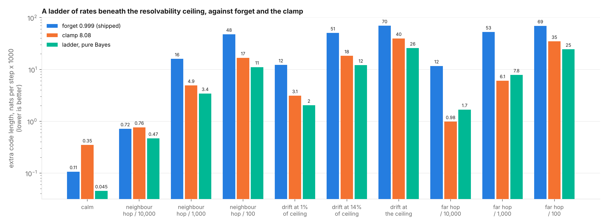
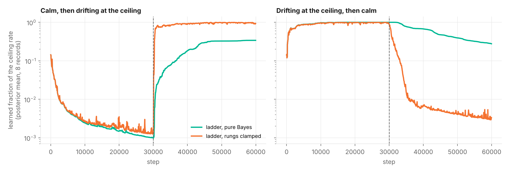

# 0003 — the ceiling as the top of a ladder; the rate found beneath it

> **AI-generated, not peer-reviewed.** Code
> [`0003_the_rate_below_the_ceiling.py`](0003_the_rate_below_the_ceiling.py), output
> [`0003_output.txt`](0003_output.txt), predictions written first in
> [`0003_predictions.md`](0003_predictions.md). Same scalar rig ([`rig.py`](rig.py)).

> **⚖️ ATTRIBUTION —** _Averaging over an unknown switching rate with a bank of
> fixed-rate filters is standard._ Prior art: mixing over share rates (Herbster & Warmuth
> 1998; de Rooij & van Erven; Koolen & de Rooij), Bayesian online change-point detection
> with an unknown hazard (Adams & MacKay 2007; Wilson, Nassar & Gold 2010), and this
> repository's own hazard ladder. Cited from memory. What is specific here is that the
> ladder's top end and the shape of the rates are fixed by resolvability rather than
> chosen. Status: RECOMBINATION + measured results.

## The construction

`0002` showed that "(phi, s) drift as fast as can be resolved" is a working model with a
standing cost whenever the world is calmer than that. Here the fastest resolvable drift is
kept only as a **ceiling**:

- `H` = neighbour rates at the stricter level `c = 1.125` nats (one over each pair's
  resolution time);
- the world drifts at an unknown fraction `a` of it, `P(a) = I + a·H`, `a` in `[0, 1]`;
- a ladder of 14 rungs (`a = 0`, then `2^-12 … 1`) each filters the bank at its own `a`,
  and the rungs are weighted by how well each predicts.

`a = 0` is pure Bayes (`forget = 1`); `a = 1` is `0002`'s rule. The unknown is one
dimensionless number on a closed interval, so the ladder is complete. The level `c` only
places the top rung. The rung count is a budget.

## Result

Extra code length, nats per step × 1000. "Best rung" is the single rung that does best in
hindsight on that scenario.

| scenario | `forget` 0.999 | clamp 8.08 | ceiling only (`a`=1) | **ladder, pure Bayes** | **ladder, rungs clamped** | best rung | its `a` | learned `a` |
|---|---|---|---|---|---|---|---|---|
| calm | 0.11 | 0.35 | 12.6 | **0.05** | **0.05** | 0.01 | 0 | 0.002 |
| neighbour hop / 10,000 | 0.72 | 0.76 | 6.7 | **0.47** | **0.47** | 0.47 | 0.002 | 0.004 |
| neighbour hop / 1,000 | 16.0 | 4.9 | 13.2 | **3.4** | **3.5** | 3.4 | 0.008 | 0.013 |
| neighbour hop / 100 | 47.8 | 16.7 | 14.7 | **11.1** | **11.1** | 11.1 | 0.125 | 0.117 |
| drift at 1% of ceiling | 12.2 | 3.1 | 10.4 | **2.0** | **2.1** | 2.0 | 0.008 | 0.009 |
| drift at 14% of ceiling | 50.6 | 18.3 | 15.5 | **12.1** | **12.1** | 12.1 | 0.125 | 0.128 |
| drift at the ceiling | 69.7 | 39.7 | 25.8 | **25.8** | **25.9** | 25.8 | 1 | 0.990 |
| far hop / 10,000 | 11.7 | **0.98** | 13.4 | 1.7 | 1.5 | 1.6 | 0.004 | 0.004 |
| far hop / 1,000 | 52.8 | **6.1** | 14.8 | 7.9 | 7.8 | 7.8 | 0.031 | 0.034 |
| far hop / 100 | 69.3 | 34.7 | 24.7 | **24.5** | **24.6** | 24.5 | 0.5 | 0.523 |
| calm, then ceiling (2nd half) | 67.8 | 39.5 | 25.5 | 31.3 | **25.9** | 25.5 | 1 | 0.23 |
| ceiling, then calm (2nd half) | 2.5 | **0.35** | 9.8 | 6.7 | **0.35** | 0.28 | 0.001 | 0.55 |

## Predictions against the run

| | prediction | verdict |
|---|---|---|
| R1 | the ladder lands within 20% of the best single rung in every steady scenario; calm cost falls to ~0.1e-3 | **confirmed, tighter than predicted** — within 0–3% in all nine steady scenarios with change; calm is 0.05e-3, below `forget = 0.999` (0.11) and the clamp (0.35). `0002`'s standing cost is gone |
| R2 | beats the clamp on neighbour hops and drift, loses on far hops at dwell ≥ 1000 | **confirmed** — 1.4–1.6× better on neighbour hops and drift at every rate; 1.3–1.7× worse on far hops at 1,000 and 10,000 (its moves are local); better again on far hops at 100 |
| R3 | when the rate itself changes, pure-Bayes weighting of the rungs adapts gracefully; clamping the rungs adds < 20% | **FALSE** — pure Bayes freezes in both directions (learned `a` crawls to 0.3 instead of 1, and stays near 0.3–1 instead of falling). Mild going up (31.3 against 25.5), severe going down (6.7 against 0.28, 24×). Clamping the rungs' log-odds at 8.08 nats repairs both (25.9, 0.35) |

## Reading

1. **The ceiling plus a ladder beneath it removes `forget` and removes `0002`'s price.**
   One rule is at or near the best in every steady condition from calm to the ceiling,
   with nothing chosen but a rung budget. Against the shipped `forget = 0.999` it is 1.5×
   to 7× better wherever anything changes and 2× better when nothing does.

2. **The rate is found correctly.** The learned fraction tracks the best rung across three
   decades (0.002 to 1).

3. **The constant-rate assumption is real and it bites — on the way down.** Weighting the
   rungs by pure Bayes is the claim that the drift rate is a constant of the world. After a
   long restless stretch the fast rungs hold a lead that a calm stretch of equal length
   does not erase. This is `forget = 1`'s freeze, one level up.

4. **Clamping the rungs moves the remaining constant up a level, where it is cheap.** With
   the rungs' log-odds capped at 8.08 nats the ladder matches the best rung in *every* row
   except far hops, and costs nothing in the steady rows (identical to pure Bayes to the
   second digit). The cap is now felt only when the rate of change itself changes. It was
   not swept here; one value was tried.

5. **Far hops are a different channel.** The ladder's moves are between neighbours.
   Arbitrary swaps are jumps, which `0002` showed resolvability does not bound; the
   member-level clamp handles them 1.3–1.7× better at long dwells. The shipped filter
   already has a separate jump channel (the hazard ladder), which this rig lacks.

## Limits

One scalar rig, known level, truths on the grid; the drift scenarios are generated from the
same rate table the rule reads. The rates `H` come from a `KL` table measured offline — in
the shipped filter they must be estimated online. The rung prior is uniform over the 14
rungs (roughly log-uniform in `a` with an atom at 0); not varied. Code length only.
