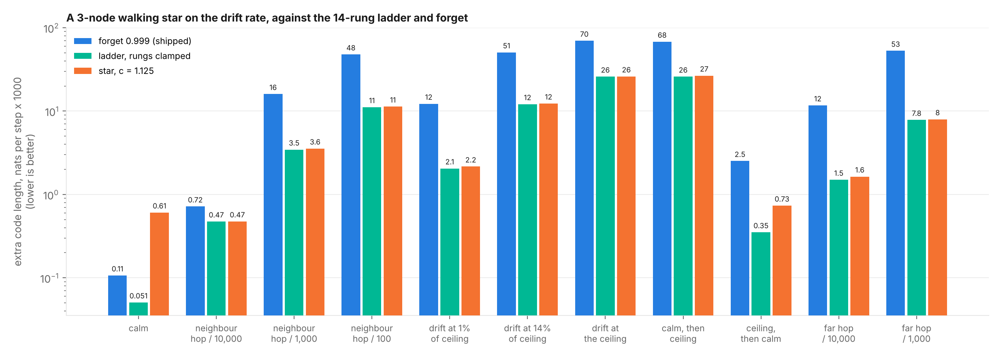
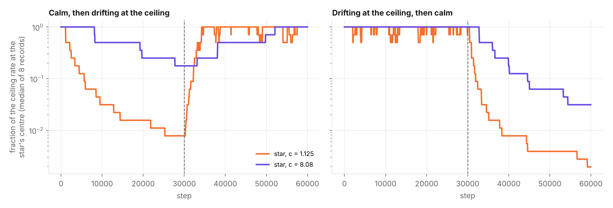

# 0004 — the drift rate on a walking star

> **AI-generated, not peer-reviewed.** Code
> [`0004_the_walking_star.py`](0004_the_walking_star.py), output
> [`0004_output.txt`](0004_output.txt), predictions written first in
> [`0004_predictions.md`](0004_predictions.md). Same scalar rig ([`rig.py`](rig.py)), same
> likelihoods as `0003`.

> **⚖️ ATTRIBUTION —** _A moving window of hypotheses recentred by a repeated sequential
> test is CUSUM (Page 1954) applied to a parameter grid; it is also this repository's own
> scale walk (centre plus arms, adaptive-grid 0013/0018) applied one level up._ Status:
> RECOMBINATION + measured results.

## The construction

`0003` found the drift rate with a fixed 14-rung ladder, and needed a cap on the rungs'
log-odds so the rate itself could change. Here the rate is tracked the way the filter
tracks a noise level: by a small window that walks.

- Coordinate `u = log2(a)`, `a` the fraction of the resolvability ceiling; `u ≤ 0`.
- **Star**: a centre at `u` and one arm either side at `u ± g`. Each node filters the bank
  under `P(2^node)`.
- **Lead**: each arm keeps the evidence by which it out-predicts the centre, floored at
  zero — an arm is never behind.
- **Walk**: when an arm leads by `c`, the star recentres on it and both leads restart.
- **Predict**: the mixture of the three nodes, an arm weighted `e^{lead − c}` to the
  centre's 1.
- Starts at the ceiling and cannot pass it.

`c = 1.125` nats is the existing grid criterion (a node is resolved from its neighbour at
1.5 blur widths), so the walk introduces no level of its own. There are no weights over
rungs to remember, hence nothing to cap.

## Result

Extra code length, nats per step × 1000.

| scenario | `forget` 0.999 | ladder, rungs clamped (`0003`) | **star, c=1.125, g=1** | star, c=1.125, g=2 | star, c=8.08 | best single rate |
|---|---|---|---|---|---|---|
| calm | 0.11 | 0.05 | 0.61 | 0.20 | 4.68 | 0.01 |
| neighbour hop / 10,000 | 0.72 | 0.47 | **0.47** | 0.52 | 1.44 | 0.47 |
| neighbour hop / 1,000 | 16.0 | 3.45 | **3.55** | 3.84 | 4.99 | 3.40 |
| neighbour hop / 100 | 47.8 | 11.1 | **11.3** | 11.7 | 11.6 | 11.1 |
| drift at 1% of ceiling | 12.2 | 2.05 | **2.16** | 2.32 | 3.28 | 2.03 |
| drift at 14% of ceiling | 50.6 | 12.1 | **12.3** | 12.7 | 12.5 | 12.1 |
| drift at the ceiling | 69.7 | 25.9 | **26.0** | 26.5 | 25.8 | 25.8 |
| far hop / 10,000 | 11.7 | 1.50 | 1.64 | 1.57 | 2.10 | 1.63 |
| far hop / 1,000 | 52.8 | 7.83 | 7.97 | 7.90 | 8.68 | 7.79 |
| far hop / 100 | 69.3 | 24.6 | 24.7 | 25.0 | 24.6 | 24.5 |
| calm, then ceiling (2nd half) | 67.8 | 25.9 | **26.6** | 26.7 | 27.6 | 25.5 |
| ceiling, then calm (2nd half) | 2.52 | 0.35 | 0.73 | **0.38** | 3.63 | 0.28 |

## Predictions against the run

| | prediction | verdict |
|---|---|---|
| S1 | within 10% of the clamped ladder in every steady scenario; calm cost 0.1–0.3e-3 | **confirmed where anything changes** (0–9% in all nine such rows). **Calm is worse than predicted**: 0.61 at `g = 1` (12× the ladder, 5× `forget`); 0.20 at `g = 2` |
| S2 | no freeze when the rate changes; calm → ceiling within 10% of the best rate, ceiling → calm within 2× of the ladder | **confirmed going up** (26.6 against 25.5). **Borderline going down** at `g = 1` (0.73, 2.1× the ladder); confirmed at `g = 2` (0.38) |
| S3 | `c = 8.08` within 15% of `c = 1.125`, slower on switches | **FALSE** — 8.08 is much worse wherever the rate is low (calm 4.68, hop/10,000 1.44) because it descends too slowly. The grid's own criterion is the right level; the larger one is wrong |
| S4 | 3 chains instead of 14, no rung cap | **as built** |

## Reading

1. **Three walking nodes do the work of fourteen fixed rungs**, to within 0–9% wherever
   the truth changes, and the star needs no cap on rung weights: the cap of `0003` is
   replaced by the walk, whose only level is the criterion the grid already uses.

2. **That criterion is selected by the data, not merely permitted.** `c = 1.125` beats
   `c = 8.08` in 10 of 12 rows and ties the other two. At the stricter level the star takes
   30,000 calm steps to get from the ceiling to a quarter of it.

3. **The price is in the calm.** An arm is never behind the centre, so each arm always
   holds at least `e^{-1.125}` of the centre's weight, and the star stops descending once a
   further halving of the rate cannot be resolved (it settles near `a = 0.004` where the
   best rate is 0). That standing cost is 0.6e-3 at one-octave arms and 0.2e-3 at
   two-octave arms, against 0.05e-3 for the ladder and 0.11e-3 for `forget = 0.999`.

4. **The arm length `g` is the remaining choice, and it is weakly felt.** One octave
   against two: within 8% in every row with change; two octaves is 3× better in calm and 2×
   better after a restless-then-calm record. It has not been derived. In the filter's own
   scale walk the spacing comes from the blur at the evidence held; the same derivation has
   not been attempted here.

5. **Far hops are unchanged** — the star, like the ladder, moves the bank between
   neighbours; jumps belong to a separate channel.

## Limits

As `0003`: one scalar rig, known level, truths on the grid, drift worlds generated from the
table the rule reads, rates from a `KL` table measured offline. Recentring copies the
nearest node's member weights to the new arm; not varied. The start (at the ceiling) is a
choice consistent with the principle; a start elsewhere was not tried.
