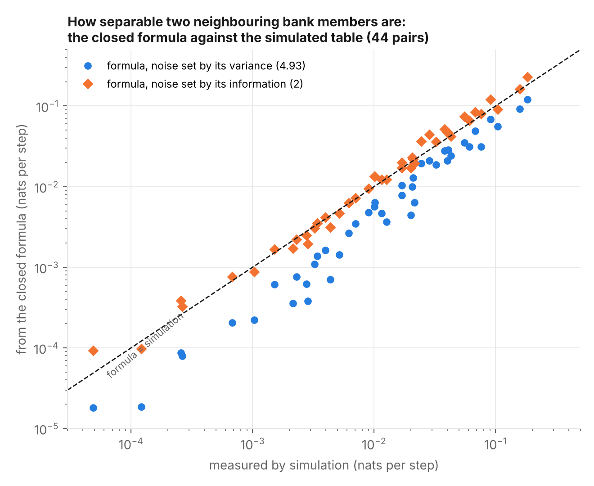

# 0005 — the rate table from its definition

> **AI-generated, not peer-reviewed.** Code
> [`0005_the_table_from_theory.py`](0005_the_table_from_theory.py) and
> [`0005b_fisher_noise.py`](0005b_fisher_noise.py), outputs alongside, predictions written
> first in [`0005_predictions.md`](0005_predictions.md).

> **⚖️ ATTRIBUTION —** _The divergence rate between stationary Gaussian processes as an
> integral of their spectral ratio is classical (Whittle 1953; Kazakos & Papantoni-Kazakos
> 1980); the log-squared linearisation of a stochastic-volatility model is Harvey, Ruiz &
> Shephard 1994; replacing a noise's variance by its inverse Fisher information is the
> locally-optimal (efficient-score) treatment of non-Gaussian noise._ Cited from memory.
> Status: RECOMBINATION + measured agreement.

## The point

`0001`–`0004` read a table `KL[i, j]` — how many nats per step separate bank member `i`
from member `j` — and obtained it by simulating each member for 30,000 steps. The table
has a definition (the Kullback–Leibler divergence rate between the two processes) and
should be computed from it. The exact rate has no closed form for a model with a hidden
level, but a closed approximation exists and is checked here against the simulation.

## The formula

In `y = log e²` a member is `y_t = lam_t + xi_t`: its AR(1) log-level plus a fixed noise
`xi = log z²`. For two such processes with spectra `f_A`, `f_B`,

    D(A || B) = (1/4π) ∫ [ f_A/f_B − 1 − ln(f_A/f_B) ] dω,
    f(ω) = s²(1 − phi²) / (1 + phi² − 2·phi·cos ω) + N.

`N` is the level of the fixed noise. Two choices:

- **its variance**, `N = π²/2 = 4.93` — the textbook Gaussian surrogate;
- **its information**, `N = 1/I = 2` — a single draw carries Fisher information `I = 1/2`
  about its own log-variance (the number this repository's resolution arguments already
  run on), so for the purpose of telling levels apart `xi` acts like Gaussian noise of
  variance 2.

## Result

Formula over simulation, on the 44 neighbour pairs the rate rules use:

| | median | range | by the pair's smaller `s`: 0.2 / 0.4 / 0.8 / 1.6 / 3.2 |
|---|---|---|---|
| `N = 4.93` (variance) | 0.45 | 0.13–0.80 | 0.25 / 0.32 / 0.50 / 0.62 / 0.73 |
| **`N = 2` (information)** | **1.05** | 0.69–1.90 | 0.90 / 0.99 / 1.05 / 1.20 / 1.42 |

The walking star of `0004`, re-run with the **variance** formula's rates (the worse of the
two) in place of the measured ones, on the same likelihoods:

| scenario | measured rates | formula rates | ratio |
|---|---|---|---|
| calm | 0.61 | 0.44 | 0.73 |
| neighbour hop / 10,000 · 1,000 · 100 | 0.47 · 3.55 · 11.3 | 0.50 · 3.64 · 11.4 | 1.05 · 1.03 · 1.01 |
| drift at 1% · 14% · 100% of ceiling | 2.16 · 12.3 · 26.0 | 2.13 · 12.3 · 26.7 | 0.98 · 1.00 · 1.03 |
| calm → ceiling · ceiling → calm | 26.6 · 0.73 | 27.2 · 0.61 | 1.02 · 0.83 |
| far hop / 10,000 · 1,000 · 100 | 1.64 · 7.97 · 24.7 | 1.77 · 8.24 · 25.2 | 1.08 · 1.03 · 1.02 |

## Predictions against the run

| | prediction | verdict |
|---|---|---|
| T1 | the variance formula is within 2× for `s ≤ 0.8` and too small at `s ≥ 1.6` | **FALSE, and backwards** — it is too small everywhere, and *worst at small `s`* (0.13–0.37 at `s = 0.2`, 0.64–0.80 at `s = 3.2`). Cause identified: a Gaussian of the same variance understates the information in `xi` by `(2/π²)/(1/2) = 0.41`, and a small difference between members is felt at second order, `0.41² = 0.16`. Using the information level `N = 2` removes it |
| T2 | rank agreement over all pairs, Spearman > 0.9 | **confirmed** — 0.976 over 210 pairs, 0.985 over neighbours |
| T3 | the star on formula rates is within 10% of the star on measured rates | **confirmed** — 0.73–1.08 in all twelve scenarios, with rates that were 2–7× too small. The star finds the fraction itself, so a table wrong by a common factor is absorbed (it simply sits one rung higher) |

## Reading

1. **The table is a calculation, not a measurement.** With the information-equivalent
   noise level the closed formula reproduces the simulated neighbour rates to a median 5%,
   and to within about ±40% across the grid. It needs only `(phi, s)` of the two members.

2. **Even a poor table suffices.** The rule's performance moved by under 8% when the rates
   were wrong by 2–7×. What the star needs from the table is the *relative* rates between
   pairs (the ranking is correct to 0.98); the overall scale is what it walks to find.

3. **This removes the obstacle `0003`/`0004` named.** No online estimate, and no memory
   length to average over, is needed.

4. **The remaining error has a shape.** At `N = 2` the formula runs low at small `s`
   (0.90) and high at large `s` (1.42). The information-equivalent level is exact only for
   small differences; at large spread the level's own excursions are no longer small.
   The two outliers (0.69, 1.90) are `phi`-neighbours at `s = 0.2`, where the simulated
   value is itself uncertain by ~80% (0.00005 ± 0.00004).

## What this does and does not settle for the shipped filter

Here every observation reads the level directly, so the noise level is the constant 2. In
the shipped filter how much one event says about a scale depends on the noise shares, the
sensors reporting and the state uncertainty. The natural extension is `N = 1/I` with `I`
the per-step scale information the filter already computes for its walk (`_scale_fisher`).
**That extension is stated, not tested.**
