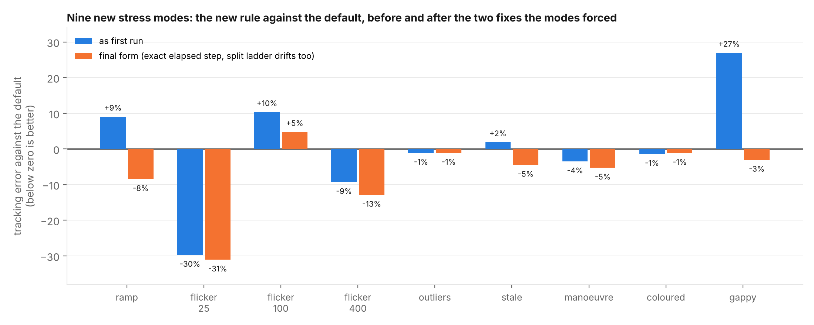

# 0012 / 0013 — new stress modes, and what the first two of them found

> **AI-generated, not peer-reviewed.** Code
> [`0012_new_stress_modes.py`](0012_new_stress_modes.py),
> [`0013_profile_the_ramp.py`](0013_profile_the_ramp.py); outputs
> [`0012_output.txt`](0012_output.txt) (final form), [`v1/0012_output.txt`](v1/0012_output.txt)
> (as first run), [`v2/0013_output.txt`](v2/0013_output.txt) (the ramp profile);
> predictions written first in [`0012_predictions.md`](0012_predictions.md) and
> [`0013_predictions.md`](0013_predictions.md).

## Why

The battery is three rigs with one schedule each, and this whole workstream was developed
against them. Nine modes were written to be unlike them, with predictions, before any was
run. All are a scalar level with time-varying noise that the filter is told nothing about;
the score is RMSE over an oracle Kalman filter that is told everything. 8 seeds, paired.

| mode | what it is |
|---|---|
| ramp | sensor noise ramps ×8 over 2000 steps and back |
| flicker 25 / 100 / 400 | sensor noise alternates ×1 / ×5 every D steps |
| outliers | 3% of readings at ×15 noise, independently |
| stale | 10,000 calm steps, then sensor ×4 |
| manoeuvre | process noise ×50 for 200 steps every 1500 |
| coloured | sensor noise is AR(1), ρ = 0.8 — outside the model class |
| gappy | the ramp, sampled at irregular gaps of 1–40 steps |

## Result

RMSE over the oracle's. "First run" is the drift as it stood when the modes were written;
"final" is after the two changes the modes forced.

| mode | fixed KF | default | drift, first run | **drift, final** | final / default | paired `t` | worst 200 steps: default / drift |
|---|---|---|---|---|---|---|---|
| ramp | 1.473 | 1.130 | 1.232 (+9%) | **1.034** | 0.917 | **−7.4** | 2.17 / 1.40 |
| flicker 25 | 1.959 | 2.024 | 1.422 | **1.395** | 0.694 | **−6.7** | 4.47 / 3.32 |
| flicker 100 | 1.621 | 1.289 | 1.422 | 1.391 | 1.073 (24 seeds: 1.043) | +1.7 (24 seeds: **+2.2**) | 2.51 / 4.02 |
| flicker 400 | 1.552 | 1.456 | 1.320 | **1.268** | 0.870 | **−7.1** | 3.66 / 3.71 |
| outliers | 2.146 | 1.150 | 1.137 | 1.137 | 0.989 | −1.1 | 2.13 / 1.86 |
| stale | 1.220 | 1.177 | 1.199 (+2%) | **1.124** | 0.955 | **−8.0** | 3.57 / 3.04 |
| manoeuvre | 1.596 | 1.305 | 1.259 | **1.236** | 0.947 | **−16.6** | 1.88 / 1.76 |
| coloured | 1.000 | 1.454 | 1.433 | **1.437** | 0.988 | **−23.0** | 1.99 / 1.99 |
| gappy | 1.516 | 1.070 | 1.358 (+27%) | **1.037** | 0.969 | **−6.2** | 1.89 / 1.59 |

`stale`, 300 steps after the change: 2.27 (default) against 1.84 (drift); in the calm
before it, 1.0048 against 1.0046.

Log-likelihood per step is higher under the drift on six modes and **lower** on three:
ramp (−0.8e-3, `t` = −4.9), stale (−0.5e-3, `t` = −5.6) and coloured (−5.0e-3, `t` = −17.6).

## Predictions against the run

| mode | prediction | first run | final |
|---|---|---|---|
| ramp | within ±3% | **FALSE** (+9%, `t` = +9.95) | false the other way (−8%) |
| flicker | better at 100 and 400, same at 25 | **FALSE** — much better at 25 (−29%), better at 400, *worse* at 100 (unresolved) | the same pattern |
| outliers | within ±3% | confirmed | confirmed |
| stale | better after the change, within 1% in calm | confirmed in both parts; **+2% overall**, not predicted | −4.5% overall |
| manoeuvre | better or equal | confirmed | confirmed |
| coloured | both degrade; within ±5% | confirmed | confirmed |
| gappy | within ±3%, finite | **FALSE** (+27%, `t` = +19) | confirmed (−3%) |
| the worry line: worse by > 10%, or a worst block > 2× the default's | | **crossed** on gappy | not crossed (worst is flicker 100, +7%, block 1.6×) |

## What the two failures were ([`0013`](0013_profile_the_ramp.py))

**The ramp.** Profiled by phase and by arm:

| arm | whole | rising | falling |
|---|---|---|---|
| default | 1.130 | 1.171 | 1.125 |
| `forget = 1` | 1.300 | 1.325 | 1.355 |
| drift (v2) | 1.233 | 1.271 | 1.255 |
| drift, state step off | 1.247 | 1.287 | 1.273 |
| **drift, with `0.999` kept on every other bank dimension** | **1.074** | 1.108 | 1.058 |
| a single class, any of three tried | 1.136–1.150 | 1.17–1.19 | 1.13–1.15 |

The drift and pure Bayes were both worse than *any single class*. A mixture worse than each
of its members means the fault is in a dimension the classes do not span: the **split
ladder** (how a channel's noise divides between process and sensor). A ramp in sensor noise
moves the split; under the drift the split's weights ran as pure Bayes and could not
follow. Keeping any forgetting there turned a 9% loss into a 5% win. The four predictions
of `0013` (state step not the cause; loss on the flanks; `forget = 1` as good as the
default) came out: right, right, and **wrong** — `forget = 1` is the worst arm, which is
what pointed at the frozen dimension.

**The fix** is the same principle applied to the split: neighbouring rungs may swap no
faster than they can be resolved, with the rate read from the metric the ladder is already
built in (`2/mem` per step for one pair). It adds no constant.

**The gaps.** Two things. A first-order chain step with a row cap made every node of the
star identical once a gap was long, pinning the walk at the ceiling; the exact `exp(τG)`
removes the cap. That alone did not help (1.358 → 1.349) — the record is a ramp, and the
ramp's fault was the real one.

## What is left

- **Flicker at 100 steps is a small resolved loss.** On 24 seeds
  ([`0012b_output_flicker100_24seeds.txt`](0012b_output_flicker100_24seeds.txt)): 1.331
  (default) against 1.394 (drift), +4.3%, paired `t` = +2.2, with a worse worst block (4.0×
  against 3.3×) — and a log-likelihood that is *better* at `t` = +24. The dwell sits between
  the two regimes the drift wins (25 and 400); not profiled.
- **Log-likelihood is lower on three modes** where RMSE is better. On ramp and stale the
  size (0.5–0.8e-3 nats/step) is that of the standing cost measured on the scalar rig; on
  coloured (5e-3) it is larger and unexplained.
- All nine modes are scalar. None exercises several sensors, a dynamics change, or the
  offset channel.
