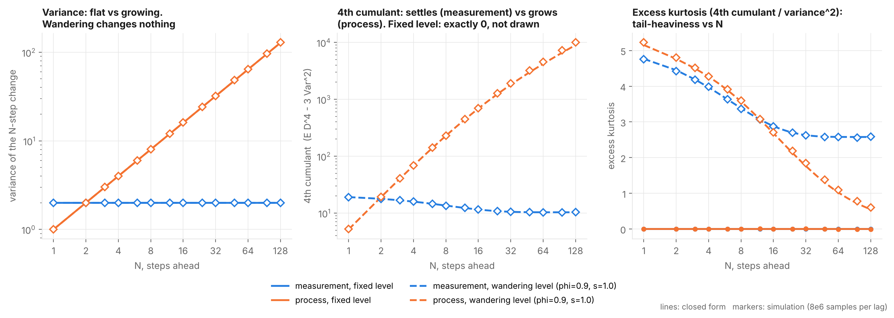
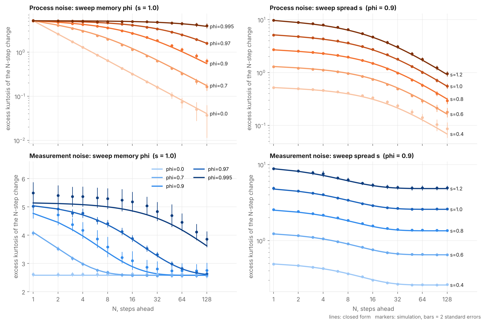
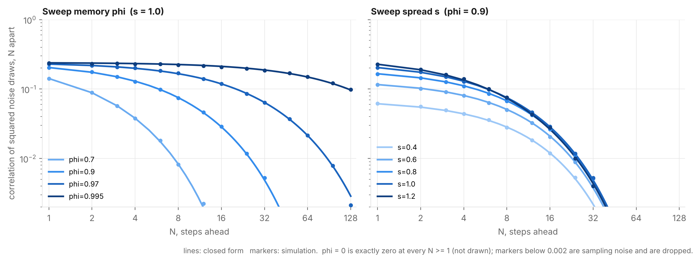

# 0018 — the moments of the N-step change, one pure regime at a time

> **AI-generated, not peer-reviewed.** Code [`0018_moments_by_lag.py`](0018_moments_by_lag.py),
> output [`0018_output.txt`](0018_output.txt). Closed forms checked against simulation
> (2000 paths × 4000 steps, 8e6 samples per lag); nothing here touches the filter.

## The question

The process/measurement split is read off the second moment at two lags: the part of the
variance that sits still is measurement noise, the part that grows is process noise. What
do the remaining two parameters of the class — the memory `phi` and spread `s` of a
wandering noise level — do to the moments as the lag `N` grows, and could they be told
apart the same way?

## Setup

    x_{t+1} = x_t + w_t,    w_t ~ N(0, Q · exp(lam_q,t − s²/2))
    y_t     = x_t + v_t,    v_t ~ N(0, R · exp(lam_r,t − s²/2))
    lam_{t+1} = phi · lam_t + s · sqrt(1 − phi²) · eps_t

`lam` is a log-variance, stationary with variance `s²` and lag-`k` correlation `phi^k`. This
is the shipped `(phi, s)` chart: `s` is the **stationary spread**, not the per-step
increment (`lucid.py` uses innovation variance `s²(1 − phi²)`). The `− s²/2` holds the mean
variance at `Q` or `R` whatever `(phi, s)` is. Each noise has its own `(phi, s)`.

The observable is the lag-`N` change `D_N = y_{t+N} − y_t`. A *pure regime* switches one
noise on and the other off. Odd moments vanish by symmetry, so the content is in the
variance and the fourth cumulant `c4 = E D⁴ − 3 Var²` (zero for any Gaussian; excess
kurtosis is `c4 / Var²`).

## The closed forms

| regime | `Var D_N` | `c4(D_N)` |
|---|---|---|
| measurement, fixed level | `2R` | `0` |
| process, fixed level | `N·Q` | `0` |
| measurement, wandering level | `2R` | `6R² [ (e^{s²} − 1) + (e^{s²·phi^N} − 1) ]` |
| process, wandering level | `N·Q` | `3Q² Σ_{i,j=1..N} (e^{s²·phi^|i−j|} − 1)` |

**Derivation.** Given the levels, `D_N` is Gaussian with variance `V` = the sum of the
variances of the draws it contains (two for measurement, `N` for process), so
`E D² = E V` and `E D⁴ = 3 E V²`, hence `c4 = 3 Var(V)`. With the normalisation above,
`E[exp(lam_i + lam_j − s²)] = exp(s²·phi^|i−j|)` (a log-normal mean), which gives both rows.
In words: **the fourth cumulant is three times the variance of the accumulated noise
level.**

Cumulants of independent parts add, so in a mixed record `c4` is the sum of the two
wandering rows, exactly as the variance is `N·Q + 2R`. Checked: simulation over the sum of
closed forms is 0.98–1.04 across all lags on a record with both levels wandering.

A two-time companion, for the raw noise draw `e` (`w` or `v`):
`Corr(e_t², e_{t+N}²) = (e^{s²·phi^N} − 1) / (3e^{s²} − 1)`.

## What the curves say

1. **The second moment is blind to `(phi, s)`.** A wandering level leaves the variance
   curve exactly where the fixed level put it (simulation within 1.2%). The variogram
   separates `Q` from `R` and nothing else.

2. **The fourth cumulant repeats the variogram's split one level up.** The measurement
   part *settles*: it starts near `12R²(e^{s²} − 1)` and falls to the constant
   `6R²(e^{s²} − 1)` once `N` passes the level's correlation time. The process part *grows*: like `N` when the level has no memory,
   like `N²` when it never moves. Sits-still against grows, again.

3. **`s` sets the height, `phi` sets the bend.** At `N = 1` the process kurtosis is
   `3e^{s²}` — `phi` does not appear. `phi` enters only through how the curve relaxes over
   `N`, on the scale `1/(1 − phi)` steps.

4. **Two lags pin `(s, phi)`, as two lags pin `(Q, R)`.** For the process regime, with `k_N`
   the (non-excess) kurtosis: `s² = ln(k_1/3)` and `phi = ln(2k_2/3 − k_1/3) / s²`. The
   script recovers `(1.0000, 0.9000)` from the closed forms at `N = 1, 2`. Every further lag
   is then a *prediction* of the AR(1) shape, not a new unknown — which is where a test of
   the shape itself would live.

5. **Both ends of `phi` are degenerate, for opposite reasons.**
   - `phi = 0`: the level is redrawn every step. The noise is then just independent draws
     from one fixed heavy-tailed distribution. Excess kurtosis is `3(e^{s²} − 1)/N` (process)
     or flat (measurement), the squared-draw correlation is zero at every lag, and no
     statistic can tell "wandering level" from "fixed non-Gaussian noise". **This is the
     exact content of "the noise moves too fast to learn anything".**
   - `phi → 1`: the level never moves within the record. Kurtosis is flat in `N` at
     `3(e^{s²} − 1)`, but that is an average over records; inside one record the level is a
     single unknown constant and the increments look Gaussian.

   So `phi` is learnable only while its correlation time `1/(1 − phi)` sits between one step
   and the record length. That is a two-sided resolvability window, and it is the fourth-order
   twin of ledger row C3 (a stationary class with `phi` near 1 is indistinguishable from a
   wandering one over a finite record).

6. **The squared-draw correlation isolates `phi` most cleanly.** Its shape over `N` is set
   by `phi` (close to `phi^N` when `s` is small), its height by `s`. It is the same for
   process and measurement draws, so it measures the wander but not which noise carries it;
   the growth of `c4` (reading 2) does that.

## On the coordinates

`(phi, s)` as shipped is already the separated chart for these curves: `s` is read from the
height at `N = 1`, `phi` from the shape over `N`. That agrees with
[`0002`](0002_the_ridge.md), which found the data's stiff direction is the stationary
variance `s²` and its flat direction is `phi` at fixed `s²`. Had `s` meant the per-step
increment, height and bend would mix. On the lag axis the natural form of `phi` is the
correlation time `tau = −1/ln(phi)`.

## Limits of what is shown

- **Stationary only.** `phi = 1` exactly (a level that random-walks without reverting) has
  no stationary spread; its moments depend on how long the level has been wandering. Not
  computed here.
- **Kurtosis is a picture, not an estimator.** The sampling error of a fourth moment is
  set by the eighth, which for a log-normal level grows like `e^{c·s²}` with a large `c`.
  Even at 8e6 samples per lag the bars are visible at `s = 1`; one cell of twenty reaches
  `|z| = 3.3`, the rest are under 2.6. The filter learns `(phi, s)` through the likelihood,
  which is far more efficient; these curves show *where in lag* the information sits, not
  how much of it there is.
- **Not done:** the per-lag Fisher information for `(phi, s)`, which would turn reading 5's
  window into a number comparable with the split channel's 1 per step
  ([`0009`](0009_the_axiom_relocated.md)).
